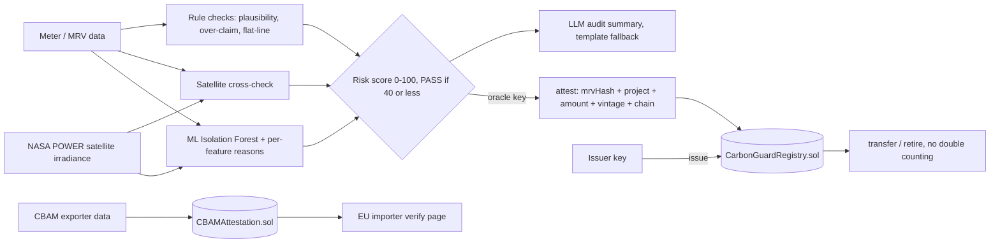

# CarbonGuard+: AI- and satellite-verified carbon credits with on-chain double-counting prevention
**IEEE ClimateChain Global Hackathon 2026 · Track: Carbon Markets & Emissions Transparency**


## 🔴 Live demo
**https://coupons-holes-thereof-zones.trycloudflare.com** — public, rate-limited demo (in-process Hardhat chain on our server; it resets on restart, and the tunnel URL may change if the server restarts). Pages: `/` credits + satellite + ML, `/cbam.html`, `/verify.html`.

## v2 upgrade (Oct 25, 2026)
- **Trained ML anomaly model:** a pure-JS Isolation Forest (`ai/ml.js`, 150 trees) trained by `scripts/train_model.js` on 3,000 synthetic honest PV projects driven by **real NASA POWER daily irradiance for 6 Indian cities (2025)**. Held-out results: 2.2% false alarms on honest data; detection 93.5% cloud-ignoring data, 99% spikes, 100% copy-paste, 52.5% meter scaled x1.3-1.8, 4.5% claim-only inflation (claim inflation is caught by the rule layer instead). Each verdict lists the features outside the honest range, with a reason.
- **LLM audit summary** (`ai/llm.js`): a plain-English summary through OpenRouter (deepseek-chat) that only explains and never changes the score. Without a key, or on an error or timeout, it falls back to a deterministic template.
- **Security fixes** from the OpenClaw review (see Links), plus a cleaner dashboard. New screenshots: `screenshots/v2_*.png`.



## Problem
Voluntary carbon markets have a trust crisis.
- Credits get **over-issued**: claims exceed what the measured data supports.
- Credits get **double counted**: the same reduction is sold twice, under two serials or in two registries.
- Credits get claimed again after retirement.
- Verification is slow, manual, and opaque.

## Solution
CarbonGuard+ puts an **explainable AI verifier** in front of a **smart-contract registry**:
1. A project uploads its MRV data: sensor readings, capacity, and the claimed tCO2e.
2. The **AI verifier** checks the data and returns a 0–100 risk score with plain-English findings. It looks for:
   - robust anomaly detection (MAD z-score),
   - flat-lined or copy-pasted data,
   - physical plausibility (for example PV capacity-factor limits),
   - claim vs. data-supported tonnes (using the India CEA grid factor of 0.71 tCO2/MWh).
3. The verifier **attests** the score on chain against the dataset's canonical SHA-256 **MRV hash**.
4. `issue()` succeeds only if:
   - an attestation exists,
   - the risk is ≤ the threshold (default 40),
   - the registry+serial pair has never been used, **and**
   - the MRV data hash has never been used.

   That last check means the same data can't be resold under a new serial.
5. Credits can be transferred and **retired** permanently to a named beneficiary through an auditable event.

## Architecture
```
MRV data ──> AI verifier (ai/verifier.js) ──risk+hash──> CarbonGuardRegistry.sol (attest → issue → transfer → retire)
                     │                                              │
                     └──────── Web dashboard (public/) via Express API (scripts/server.js) ┘
```
- `contracts/CarbonGuardRegistry.sol`: roles (admin, verifier, issuer), risk gate, serial and MRV uniqueness, and retirement.
- `ai/verifier.js`: a dependency-free, explainable risk model.
- `data/`: an honest solar dataset and a fraudulent one (spikes plus a 3.3× over-claim).

## Run
```bash
npm install
npm test          # 28 tests: registry + roles + amount binding, AI rules, ML model, LLM fallback, satellite, blinded hashes, CBAM
node scripts/train_model.js   # retrain the Isolation Forest -> ai/model/iforest.json
npm start         # local in-process chain + dashboard on http://localhost:8787
```
**Testnet only:** `TESTNET_PRIVATE_KEY=<fresh faucet wallet> npm run deploy:amoy`. The deploy script refuses mainnet chain IDs. Never use real funds.

## Demo flow
1. Load the honest project, run AI verification (**PASS, 0/100**), and issue it on chain.
2. Load the fraud project. The AI scores it **85/100**, and the contract reverts with `RiskTooHigh(85)`.
3. Re-submit the honest project. The contract reverts with `DuplicateSerial`, so double counting is blocked.
4. Retire the credits for "Acme Corp". The batch shows as fully retired and can't be re-retired.

Screenshots are in `screenshots/`.

## Impact and scale
- **Who it's for:** registries (Verra, Gold Standard, India's CCTS), project developers, buyers, and auditors.
- **Adoption:** the verifier runs as a pluggable oracle, and the contract is EVM-standard and should port to Polygon or Ethereum L2s. **Status:** the public demo runs an in-process Hardhat chain on a server; no public-testnet deployment yet (faucets needed captchas).
- **Roadmap:**
  - IoT device signatures,
  - satellite NDVI for reforestation (solar satellite cross-check already done),
  - a decentralized verifier quorum,
  - ERC-1155 credit tokens,
  - cross-registry hash sharing to stop cross-registry double counting.

## Responsible AI and security
- The model is explainable, so every score lists its reasons.
- A human-set threshold controls issuance.
- Only hashes go on chain, so no raw data is exposed.
- Role-based access is enforced, and custom errors are used throughout.

MIT License.

## CarbonGuard+ upgrade
- **NASA POWER satellite cross-check** (`ai/satellite.js`): reported solar output is checked against real sunlight data for the site (correlation + physical maximum). The result feeds the risk score.
- **CBAM attestation** (`contracts/CBAMAttestation.sol`, `ai/cbam.js`, `/cbam.html`, `/verify.html`): exporters attest embedded emissions, and EU importers can verify a commitment or detect tampering.
- **Privacy (zk-ready):** HMAC-blinded MRV fingerprints and salted commitments. No raw data goes on-chain.
- **Tests:** `npx hardhat test` gives 28 passing. Security notes are in `SECURITY.md`.
- **Testnet:** `npx hardhat run scripts/deploy.js --network sepolia` (needs a funded key in env `PRIVATE_KEY` or `.secrets/testnet_wallet.json`).
- **Demo:** `npx hardhat run scripts/server.js`, then open http://localhost:8787

## Links
- Video: https://youtu.be/o0IkQtv9OPE
- Independent AI security review (OpenClaw agent): `docs/OPENCLAW_REVIEW.md`. Fixed in v2: findings #1 (separate admin / oracle / issuer keys + rate-limited public API, optional API key / read-only mode), #2 (attestation bound to amount, project, vintage, chain and contract; no overwrite), #4 (`abi.encode` instead of packed strings), #7 (fail-closed scoring on missing satellite data / malformed input), #8 path-traversal part (validated lat/lon). Still open: #3 (fuzzy dedupe), #5, #6, multisig/EIP-712.
